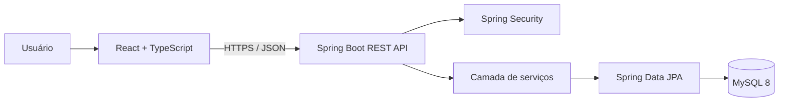

# Arquitetura inicial

## Visão geral

O sistema será organizado como uma aplicação web cliente-servidor:

O backend é a autoridade para regras de negócio, autenticação, autorização, cálculo de custos, movimentação de estoque e indicadores. O frontend não deve persistir dados operacionais em LocalStorage nem substituir a API por serviços BaaS.

## Backend

Organização por domínio, mantendo camadas explícitas:

- `controller`: endpoints REST e contratos HTTP.
- `service`: regras de negócio e transações.
- `repository`: acesso a dados via Spring Data JPA.
- `entity`: entidades persistentes.
- `dto`: objetos de entrada e saída da API.
- `mapper`: conversão entre entidades e DTOs.
- `config`: configuração da aplicação, OpenAPI e segurança.
- `exception`: erros padronizados e tratamento global.
- `validation`: validações reutilizáveis.

## Frontend

- `app`: inicialização, rotas e providers.
- `components`: componentes compartilhados.
- `features`: telas e regras agrupadas por módulo.
- `services`: cliente HTTP e integração com API.
- `hooks`: hooks reutilizáveis.
- `types`: contratos TypeScript.

## Domínios principais

Equipment, WorkOrder, MaintenancePlan, Part, StockMovement, Supplier, Employee, MeterReading, CostRecord, Attachment, User e AuditLog.

## Decisões e invariantes

1. Identificadores internos são gerados pelo backend.
2. Valores financeiros usam DECIMAL no MySQL e BigDecimal no Java.
3. Toda saída de estoque para manutenção referencia uma ordem de serviço.
4. Movimentações e histórico de status devem preservar rastreabilidade.
5. Encerramento de OS exige os campos obrigatórios conforme o tipo de serviço.
6. Indicadores exibem período e denominadores; sem dados suficientes, retornam N/D.
7. Horímetro/hodômetro é registrado como leitura datada, não apenas sobrescrito.
8. Dados de demonstração devem ser identificados como fictícios.

## Etapas de implementação

1. Fundação, configuração local, modelo de dados e contratos.
2. Equipamentos e leituras de horímetro/hodômetro.
3. Ordens de serviço, status e histórico.
4. Estoque, mão de obra, terceiros e custos.
5. Planos preventivos e geração de OS.
6. Indicadores, dashboard e relatórios.
7. Segurança, auditoria, testes e endurecimento para produção.

## Segurança

Nenhuma senha, token, chave ou dado pessoal real deve ser versionado. A autorização deve ser aplicada no backend, independentemente da visibilidade dos controles no frontend.
