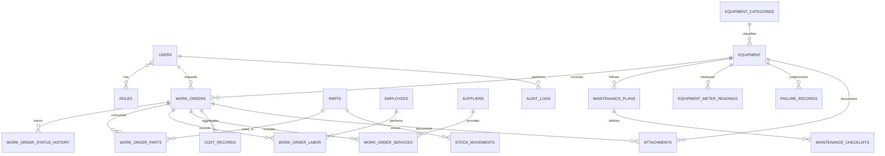

# Modelo de dados — versão inicial

Este documento descreve os domínios e relacionamentos previstos. O diagrama será refinado antes das migrations, especialmente para cardinalidades, regras de exclusão e histórico.

## Entidades e responsabilidades

| Domínio | Entidades |
|---|---|
| Acesso | users, roles |
| Ativos | equipment, equipment_categories, equipment_status, equipment_meter_readings |
| Manutenção | work_orders, work_order_status_history, maintenance_types, failure_records |
| Preventiva | maintenance_plans, maintenance_checklists |
| Materiais | parts, stock_movements, work_order_parts |
| Pessoas | employees, work_order_labor |
| Terceiros | suppliers, outsourced_services, work_order_services |
| Financeiro | cost_records |
| Rastreabilidade | attachments, audit_logs |

## Regras a formalizar nas migrations

- Uma OS pertence a um equipamento e pode conter várias peças, profissionais e serviços externos.
- Cada movimentação de estoque registra tipo, quantidade, data, usuário e referência de origem; consumo para manutenção deve apontar para a OS.
- O saldo não pode ficar negativo, salvo exceção explícita autorizada por perfil administrativo e auditada.
- Histórico de status é append-only para preservar a trilha de auditoria.
- Leituras de horímetro/hodômetro são registros históricos; leituras menores que a última leitura válida exigem tratamento de exceção.
- Custos detalhados devem ter uma origem identificável para impedir dupla contabilização.
- Exclusões não podem apagar evidências financeiras ou operacionais.

## Indicadores

MTBF, MTTR, disponibilidade e custo por hora serão calculados na camada de serviço a partir de leituras e eventos válidos. O sistema deve informar N/D quando não houver base suficiente, sem fabricar valores.
